OpenGL_ES
=========

[](https://github.com/McNopper/OpenGL_ES/actions/workflows/build.yml)

OpenGL ES 2.0, OpenGL ES 3.0, OpenGL ES 3.1 and OpenGL ES 3.2 with GLSL

## Changelog

### v1.0.1

Documentation only; no example or build changes. All 17 example
screenshots re-captured against the current stack - chrome-free 640x480
client area, static scenes pixel-exact against the previous captures.

### v1.0.0

The examples move to the McNopper/OpenGL build environment:

- **CMake build** modeled on McNopper/OpenGL: one `CMakeLists.txt` per
  example, `cppcheck`/`warnings` modules, executables in `Binaries/`.
  Requires **GLUS v1.1.5** (OpenGL ES flavors).
- **OpenGL ES providers**: ANGLE via the vcpkg manifest on Windows (optional,
  like the ANGLE backend of McNopper/EGL) and the system EGL/GLES stack on
  Linux. ES 2.0-only platforms such as the STM32MP1 Vivante GPU build the
  `*_ES2` examples.
- **Legacy build systems removed**: Eclipse CDT projects, Android NDK builds,
  the vendored GLUS copy, the prebuilt `External/` libraries and the old
  vendor DLLs.
- **Bug fixes and quality conventions ported from McNopper/OpenGL**:
  shadow texture deletion and teardown in Example12, element counts and wave
  math in Example15, the guarded inactive attribute, the double-advancing
  animation and the image leak in Example19, checked `glus*` error paths and
  `size_t` promotions everywhere, ES3 renderable bits, and a strict-ESSL
  `sampler2DShadow` precision fix. The ES2 examples narrow indices to 16-bit
  at the upload boundary (base OpenGL ES 2.0 has no 32-bit indices) - GLUS
  v1.1.6 gives every flavor one 32-bit `GLUSindex`; the previously mixed
  16/32-bit widths rendered garbage in the unified build.
- **Screenshots** for every example.

## License

The project is distributed under the **MIT License** - see [`LICENSE`](LICENSE).

These examples are built on [GLUS](https://github.com/McNopper/GLUS) (MIT).
The dependencies and bundled assets **added by this repository** - ANGLE
(BSD-3-Clause) on Windows and the bundled example assets - are documented in
[`THIRD-PARTY.md`](THIRD-PARTY.md).

## Build Instructions

### Prerequisites

**Required:**
- **CMake 3.14 or higher** - [Download](https://cmake.org/download/)
- **C/C++ Compiler**:
  - Windows: Visual Studio 2013+ (MSVC)
  - Linux: GCC or Clang
- **Git** - For fetching dependencies
- **OpenGL ES 2.0+** capable driver or implementation

**Windows additionally:**
- **[vcpkg](https://github.com/microsoft/vcpkg)** - provides ANGLE, the
  OpenGL ES implementation (EGL + GLES 2/3)

**Linux additionally:**
- the Mesa EGL/GLES development packages (`libegl-dev`, `libgles-dev`)

### Verify Installation

Check if CMake is installed:
```bash
cmake --version
```
Should show version 3.14 or higher.

### Building

GLUS is automatically fetched via CMake FetchContent, from the sibling local
checkout `../GLUS` when present (multi-repo development layout), and otherwise
from [github.com/McNopper/GLUS](https://github.com/McNopper/GLUS).

**Windows (Visual Studio, ANGLE via the vcpkg manifest):**
```bash
mkdir build && cd build
cmake .. -DCMAKE_TOOLCHAIN_FILE=<vcpkg root>/scripts/buildsystems/vcpkg.cmake
cmake --build . --config Release
```

**Linux:**
```bash
mkdir build && cd build
cmake ..
make
```

Executables will be in the `Binaries/` directory; on Windows the ANGLE DLLs
are copied there automatically. Without an OpenGL ES provider the examples
are skipped with a status message.

### Dependencies

- **GLUS v1.1.5** - Window/context boilerplate, math, image and model loading
- **ANGLE** (Windows) - EGL and GLES 2/3, via the vcpkg manifest
- **System EGL/GLES** (Linux) - Mesa on the desktop

## Examples

All examples demonstrate OpenGL ES 2.0/3.x features with GLSL (ESSL) shaders.
The `_ES2` folders contain the OpenGL ES 2.0 variants; the other examples use
OpenGL ES 3.0.

- [Example01_ES - Basic window and OpenGL ES initialization](#example01_es---basic-window-and-opengl-es-initialization)
- [Example02_ES - Rendering of a triangle](#example02_es---rendering-of-a-triangle)
- [Example03_ES - Grey filter](#example03_es---grey-filter)
- [Example04_ES - Perspective rendering of a cube](#example04_es---perspective-rendering-of-a-cube)
- [Example05_ES - Phong rendering of a sphere](#example05_es---phong-rendering-of-a-sphere)
- [Example06_ES - Texturing of a cube](#example06_es---texturing-of-a-cube)
- [Example07_ES - Normal mapping](#example07_es---normal-mapping)
- [Example08_ES - Environment/cube mapping](#example08_es---environmentcube-mapping)
- [Example11_ES - Reflection and refraction](#example11_es---reflection-and-refraction)
- [Example12_ES - Shadow mapping](#example12_es---shadow-mapping)
- [Example15_ES - Water rendering](#example15_es---water-rendering)
- [Example16_ES - Model loading and rendering](#example16_es---model-loading-and-rendering)
- [Example19_ES - Render to texture and planar reflection](#example19_es---render-to-texture-and-planar-reflection)
- [Example20_ES - Texture matrix, alpha blending and discarding](#example20_es---texture-matrix-alpha-blending-and-discarding)
- [Example01_ES2 - Basic window and OpenGL ES 2.0 initialization](#example01_es2---basic-window-and-opengl-es-20-initialization)
- [Example02_ES2 - Rendering of a triangle (OpenGL ES 2.0)](#example02_es2---rendering-of-a-triangle-opengl-es-20)
- [Example06_ES2 - Texturing of a cube (OpenGL ES 2.0)](#example06_es2---texturing-of-a-cube-opengl-es-20)

### Example01_ES - Basic window and OpenGL ES initialization


### Example02_ES - Rendering of a triangle


### Example03_ES - Grey filter

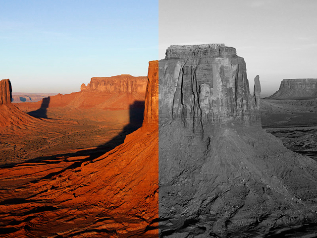

### Example04_ES - Perspective rendering of a cube

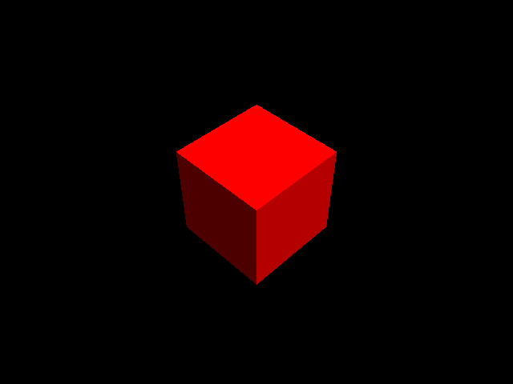

### Example05_ES - Phong rendering of a sphere

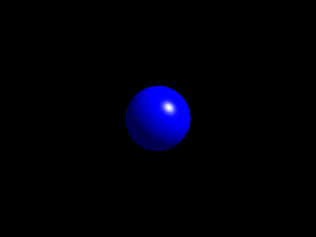

### Example06_ES - Texturing of a cube

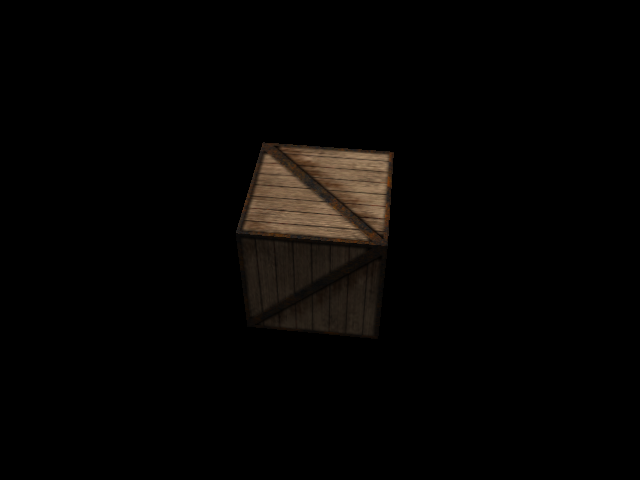

### Example07_ES - Normal mapping

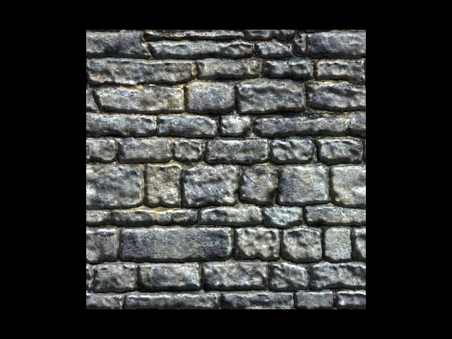

### Example08_ES - Environment/cube mapping

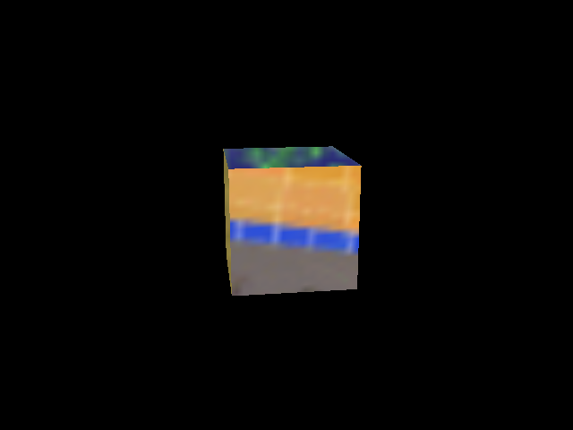

### Example11_ES - Reflection and refraction

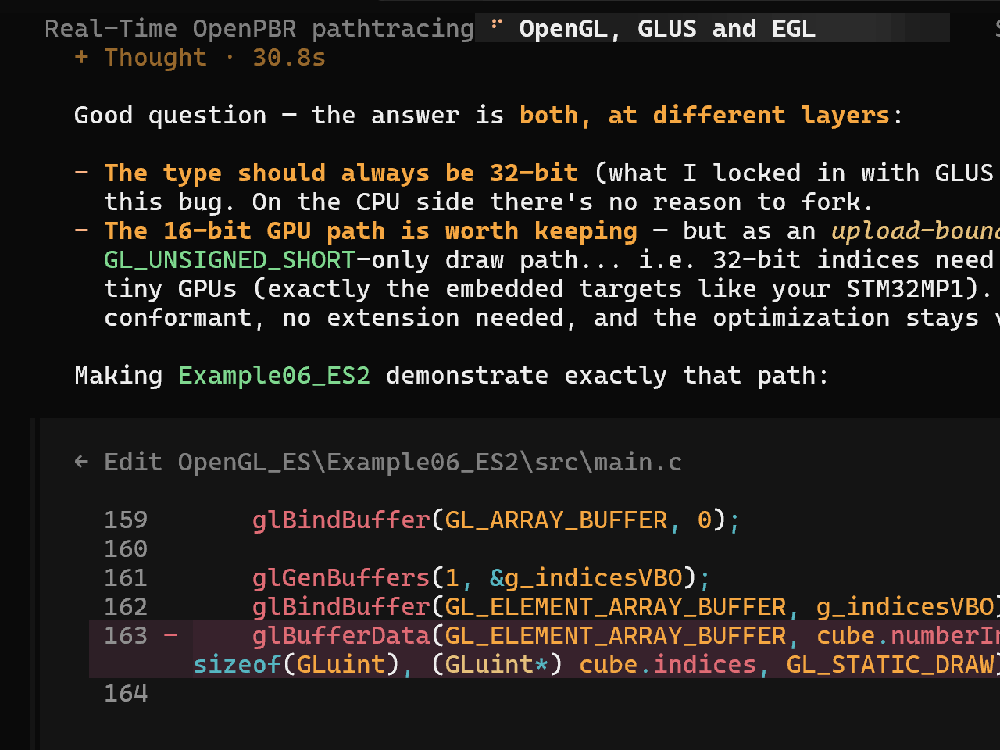

### Example12_ES - Shadow mapping

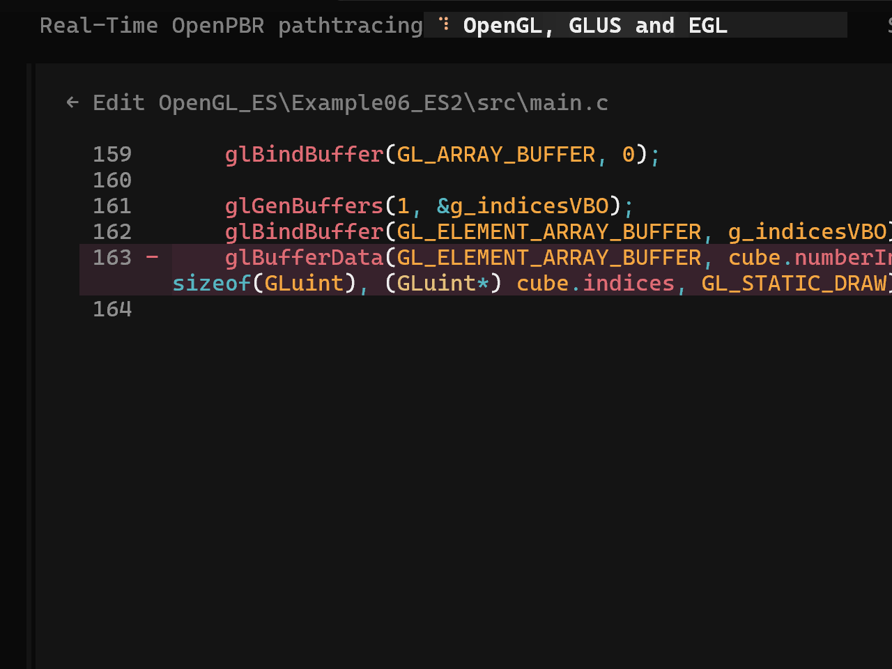

### Example15_ES - Water rendering

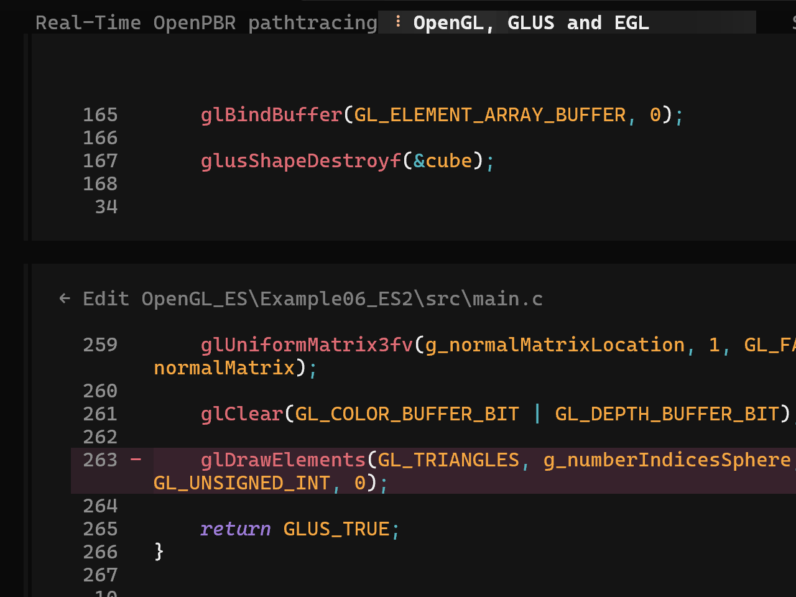

### Example16_ES - Model loading and rendering

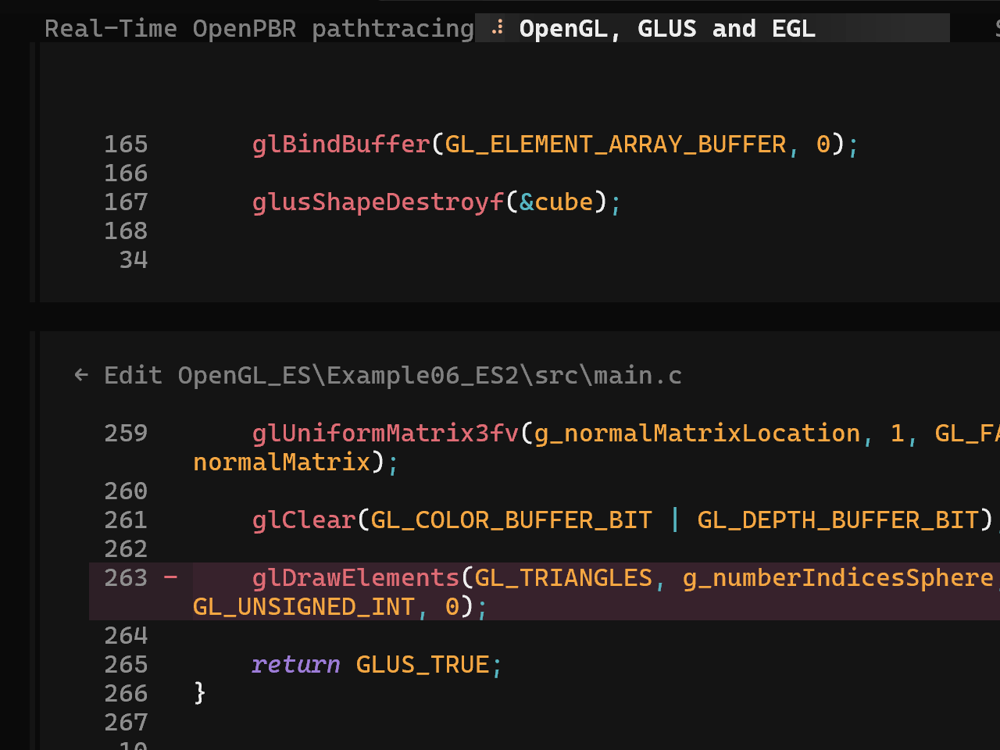

### Example19_ES - Render to texture and planar reflection

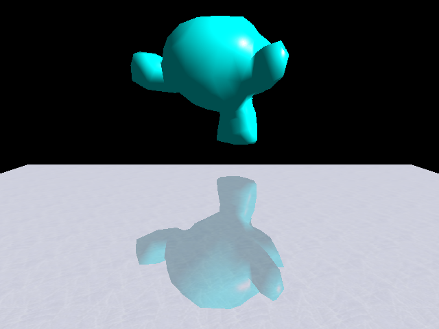

### Example20_ES - Texture matrix, alpha blending and discarding

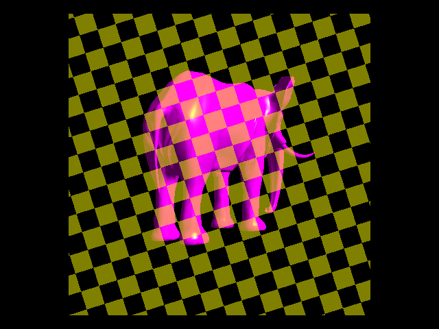

### Example01_ES2 - Basic window and OpenGL ES 2.0 initialization

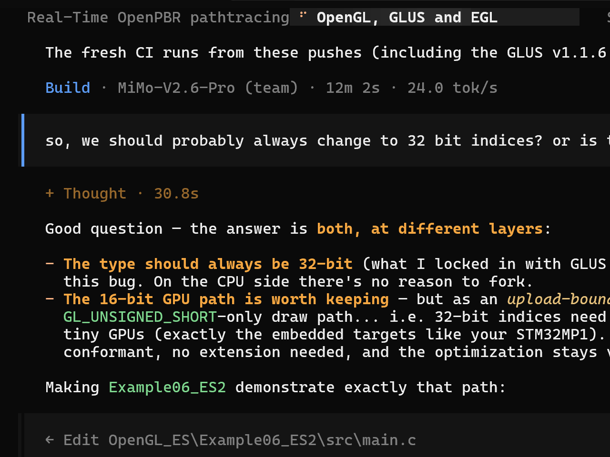

### Example02_ES2 - Rendering of a triangle (OpenGL ES 2.0)

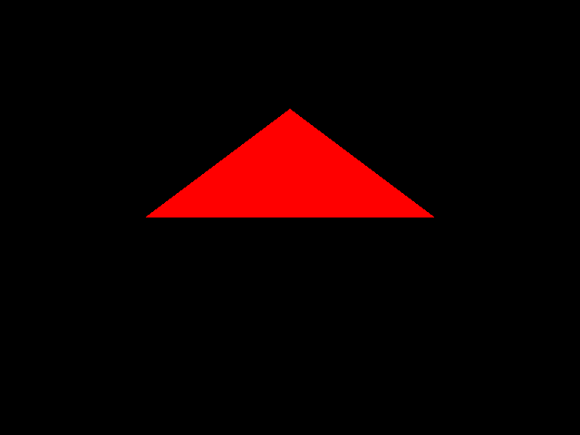

### Example06_ES2 - Texturing of a cube (OpenGL ES 2.0)

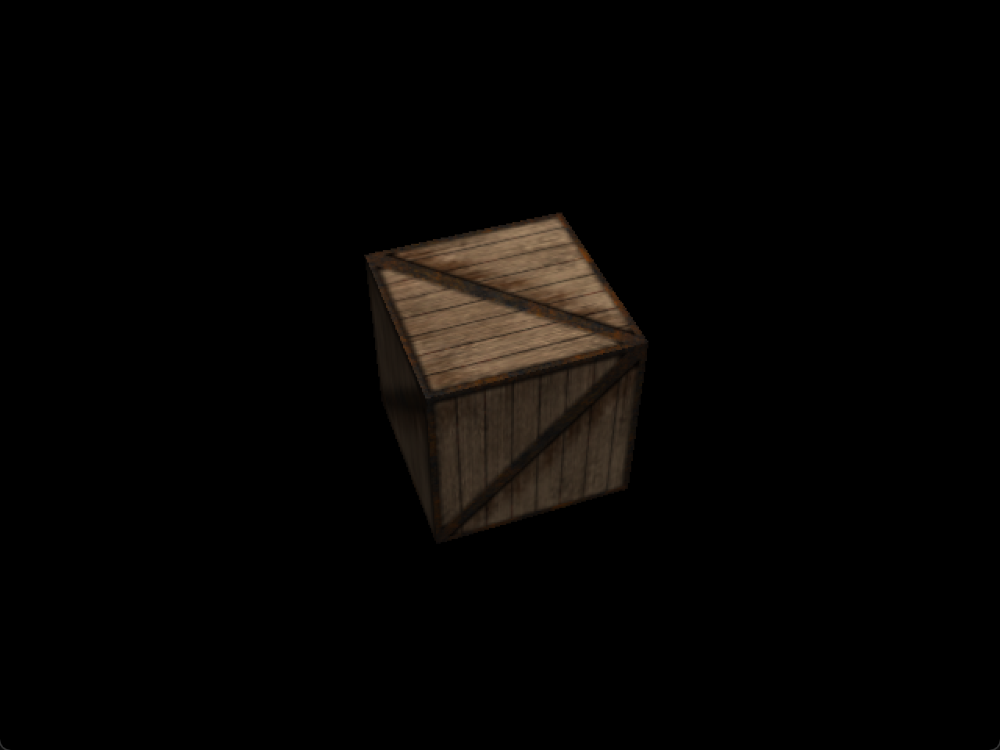
